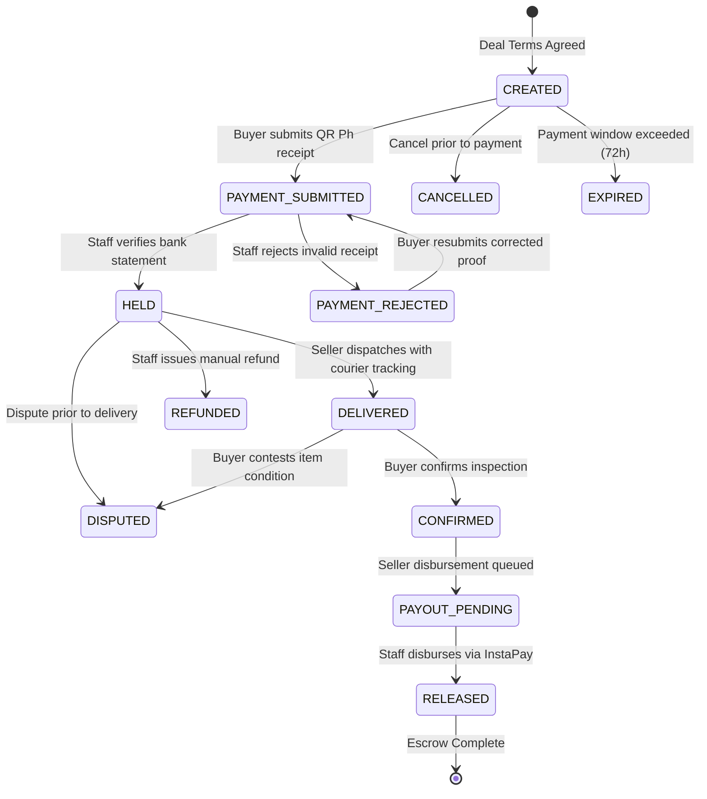

# SafeSwap — Middleman & Escrow Platform (PWA)

A trusted middleman and escrow Progressive Web App developed for the **CS111 Startup Simulation Project** (CS111 Introduction to Computing • Section 1D • Team 4).

SafeSwap provides a secure and reliable escrow service for peer-to-peer student transactions, digital services, electronics, and student freelancing/micro-gigs in the Philippines. It operates an auditable escrow flow where buyer funds are collected via **Manual QR Ph**, verified by human staff, safely protected during seller delivery and inspection, and disbursed to the seller via **QR Ph / InstaPay**.

---

## 👥 Contributors & Task To-Do Lists

### 👔 Executive Leadership
- **Danlord** (@_d4ffy) — *Chief Executive Officer (CEO)*
  - [ ] Coordinate executive milestones and project proposal
  - [ ] Coordinate integration across all departments
  - [ ] Lead final Demo Day presentation

- **Justine Roy P. Salvador** (@RealBeboy / @JRSstuff) — *Chief Technology Officer (CTO)*
  - [x] Initial repository setup and Git collaboration architecture
  - [x] System architecture, state machine, and core escrow logic
  - [x] Guide developing engineers on backend, logic & database schema

- **Fred** (@stg20) — *Chief Product Officer (CPO)*
  - [ ] Define MVP feature specifications and scope
  - [ ] Maintain list of proposed features & monitor implementation
  - [ ] Coordinate feedback between UI/UX, Engineering, and QA

- **Leian** (@.leiandra._58308) — *Chief Operating Officer (COO)*
  - [ ] Maintain team milestone schedule and task tracker
  - [ ] Coordinate meeting schedules and follow-ups
  - [ ] Document official meeting minutes archive

- **Mylde** (@myldedawn) — *Chief Marketing Officer (CMO)*
  - [ ] Target user research and value proposition
  - [ ] Draft outline for Medium Article 1 (Problem & Solution)
  - [ ] Coordinate simulated business & sustainability model

- **Genelyn** (@kimiii7264) — *Chief Financial Officer (CFO)*
  - [ ] Formulate fictional ₱500,000 startup capital budget
  - [ ] Operating expenses breakdown and financial assumptions
  - [ ] Present simulated budget during Demo Day

---

### 💻 Software Engineering
- **Vernald Laguican** (@Game-Dev-Guild) — *Software Engineer*
  - [x] Contributor onboarding and environment setup
  - [ ] Core transaction flow and logic implementation
  - [ ] Prototype feature development

- **John Kurt Montero** (@9trickyz) — *Software Engineer*
  - [x] Contributor onboarding and documentation
  - [ ] Service endpoints and database models
  - [ ] System integration and bug fixes

- **Kyl Jeion P. Hepos** (@cel3779) — *Software Engineer*
  - [ ] Module implementation and testing
  - [ ] Frontend to backend integration
  - [ ] Input validation and basic error handling

- **Shawn Michael E. Hitalada** (@avgshun) — *Software Engineer*
  - [ ] User authentication and middleware
  - [ ] Backend routing and API endpoints
  - [ ] Assist with system workflow integration

---

### 📊 Algorithms & Data
- **Lanz** (@itslanzs.) — *Algorithms & Data*
  - [ ] Program logic flow and state transitions
  - [ ] Algorithmic verification for middleman validation

- **Makkin** (@makenzzz_81841) — *Algorithms & Data*
  - [ ] Data validation and schema structure
  - [ ] Data handling and flow mapping

- **Mark Anthony S. Bacus** (@markyy28.) — *Algorithms & Data*
  - [ ] Database queries and data handling
  - [ ] Program logic planning and test verification

---

### 🎨 UI/UX Design
- **Ferdinand T. Sumile Jr.** (@toyouin2020) — *UI/UX Designer*
  - [ ] User flow diagrams and wireframes
  - [ ] High-fidelity prototype screens in Figma

- **David** (@dchoom) — *UI/UX Designer*
  - [ ] Mockups and prototype interface design
  - [ ] User interface usability and design consistency

---

### 🧪 Quality Assurance & Testing
- **Lucky** (@playful_maypole_58701) — *QA & Testing*
  - [ ] Test case creation and test matrices
  - [ ] Prototype feature testing and defect logging

- **Aldron** (@aldronlovesall) — *QA & Testing*
  - [ ] Manual testing and defect logging
  - [ ] Verify expected vs. actual outcomes

- **Josephine Anne B. Aranas** (@sejeanne) — *QA & Testing*
  - [ ] Bug tracking and edge-case testing
  - [ ] Document project limitations and test reports

---

### 📝 Research & Documentation
- **Earl** (@earlj0o_02155) — *Research & Documentation*
  - [ ] Review of Related Literature (RRL) and related systems
  - [ ] Research paper drafting (Introduction & Problem Statement)

- **Jan** (@jandarll123) — *Research & Documentation*
  - [ ] Research paper methodology and system workflow documentation
  - [ ] Academic citations and references compilation (IEEE/APA)

---

## 🛠️ Setup & Contribution Guide
1. Pull latest changes before coding:
   ```bash
   git pull --rebase origin main
   ```
2. Check off your assigned tasks as you complete them:
   - Change `[ ]` to `[x]` under your name.
3. Commit and push:
   ```bash
   git add README.md
   git commit -m "docs: update task checklist for [Your Name]"
   git push origin main
   ```
4. All pushes are automatically announced in **`#📜・git-logs`** on Discord!

---

## 1. Core Architecture & Payment Flow



### Key Security & Financial Rules
1. **System Never Holds Money Directly**: The app stores status, references, and audit events. Money is transferred manually through Philippine banking/e-wallet channels (QR Ph / InstaPay).
2. **Minor Units (Integers)**: All money amounts are stored as integers in centavos (`17500000` = `₱175,000.00`). No floating-point math is used.
3. **Four-Eyes Rule**: For seller disbursements, the system prevents the same staff member who verified the incoming deposit from also authorizing the outbound payout.
4. **Anti-Fraud Duplicate Prevention**: Bank/InstaPay reference numbers have a unique database constraint (`UNIQUE (direction, reference_number)`) so receipts can never be reused across deals.
5. **Client Cannot Modify Status or Money**: All status changes go through the Postgres `transition_deal` `SECURITY DEFINER` function or Edge Functions.

---

## 2. Legal & Regulatory Compliance Note (Philippines)

> [!IMPORTANT]
> **Regulatory Notice for Operating Escrow Services in the Philippines:**
>
> Holding customer funds in a company-owned bank account or e-wallet and releasing them upon counterparty fulfillment may classify the operator as an **Operator of Payment Systems (OPS)**, an **Electronic Money Issuer (EMI)**, or a **Trust/Escrow agent** under Bangko Sentral ng Pilipinas (BSP) circulars (Circular No. 1049, Circular No. 942, and the National Payment Systems Act - Republic Act No. 11127).
>
> **Checklist to Verify with Legal & Accounting Counsel prior to real-money launch:**
> - [ ] **BSP OPS Registration**: Determine whether SafeSwap must register as an Operator of Payment System under Circular No. 1049.
> - [ ] **Escrow Trust Agreement**: Establish an Escrow Agency Agreement with a BSP-licensed commercial bank (e.g. BDO, BPI, UnionBank) so funds sit in a dedicated Escrow Trust Account rather than general operating funds.
> - [ ] **AML/CFT Compliance (AMLC)**: Implement Anti-Money Laundering Council reporting procedures for transactions exceeding covered thresholds.
> - [ ] **KYC / Identity Verification**: Enforce Level 2 KYC (government ID verification) for single or cumulative transactions exceeding ₱50,000.00.
> - [ ] **Tax & BIR Withholding**: Clarify with an accountant whether the 3% escrow service fee requires VAT/income tax invoicing and withholding certificates (BIR Form 2307).
> - [ ] **Terms of Service**: Require all buyers and sellers to acknowledge:
>   - Manual verification SLA: Receipts verified within **2 hours** (8:00 AM – 8:00 PM PHT).
>   - Seller payout SLA: Disbursed via InstaPay within **24 hours** of buyer confirmation.
>   - Inspection window: Default **48 hours** for physical goods.

---

## 3. Tech Stack

- **Frontend**: React 18 / 19, TypeScript, Vite, Tailwind CSS tokens, Radix UI primitives.
- **PWA**: `vite-plugin-pwa` (Workbox) with offline precaching, standalone display, and install prompts.
- **Backend**: Supabase (Postgres with migrations in VC, Auth, RLS, Storage, Realtime, Edge Functions).
- **Offline / Local**: TanStack Query persisted cache (24h localStorage) + Dexie.js (IndexedDB) offline mutation queue.
- **Testing**: Vitest (54 unit tests), SQL RLS isolation tests, Playwright e2e harness.

---

## 4. Local Development Flow

### Prerequisites
- Node.js 18+
- npm or pnpm

### Setup
```bash
# Clone and install dependencies
git clone https://github.com/JRSstuff/middlemanservice.git
cd middlemanservice
npm install

# Environment variables
cp .env.example .env
```

### Run Dev Server
```bash
npm run dev
```

### Run Tests
```bash
# Run all Vitest unit tests (state machine, QR Ph provider, offline queue, components)
npm test

# Run build check
npm run build
```

---

## 5. Staff Console (`/staff`) & Verification Operations

Authorized staff members can access the Staff Console at `/staff` to review incoming payments, disburse seller funds, and handle disputes under an auditable workflow.

### How Staff Verify a Payment:
1. Navigate to `/staff` (requires user with staff role or dev test user).
2. On the **Incoming Payments** tab, select a pending transaction in `PAYMENT_SUBMITTED` status.
3. Review the buyer's uploaded proof receipt and stated reference number against SafeSwap's banking/e-wallet app statement.
4. Verify the exact amount received matches the required total centavos.
5. **If verified**: Click **Verify Deposit**. The deal moves to `HELD`, and the seller's dashboard updates to "Payment verified, funds held".
6. **If invalid or amount mismatch**: Click **Reject**, select or type the rejection reason. The status changes to `PAYMENT_REJECTED`, notifying the buyer to resubmit proof.

### How Staff Record a Payout:
1. Once a buyer confirms delivery inspection, the deal automatically moves to `PAYOUT_PENDING`.
2. Staff navigate to `/staff` and switch to the **Seller Payouts** tab.
3. Open the deal to reveal the seller's verified payout channel (GCash / Maya / Bank Name, Account Number, and Account Name).
4. Perform the manual transfer via InstaPay or QR Ph in the corporate banking app for the exact net amount (`amount_centavos - fee_centavos`).
5. In SafeSwap, enter the outbound InstaPay / bank reference number and upload the disbursement screenshot.
6. Click **Confirm Payout**.
   - *Note on Four-Eyes Rule*: The system enforces that the staff member who authorized the initial deposit verification cannot also execute the seller payout for that same deal. A second authorized staff member must record the payout.
7. The deal transitions to `RELEASED`. The seller receives the payout notification and timeline confirmation.
